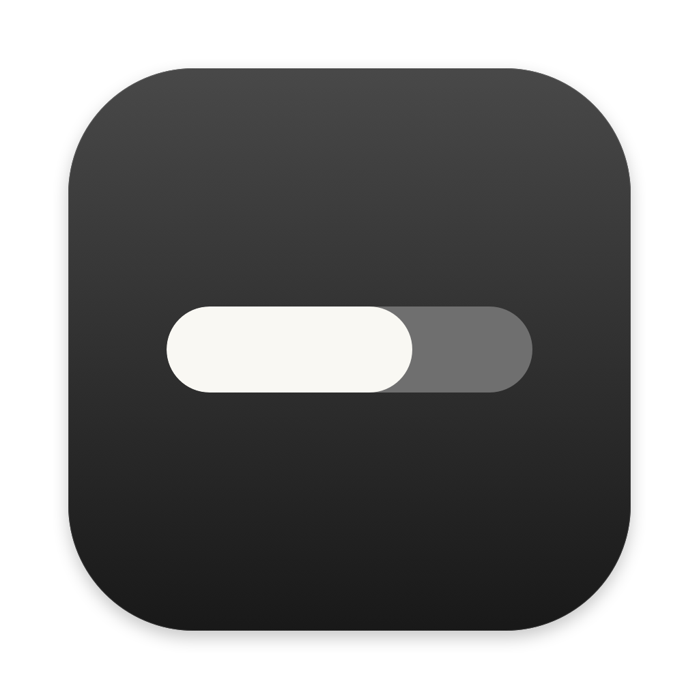
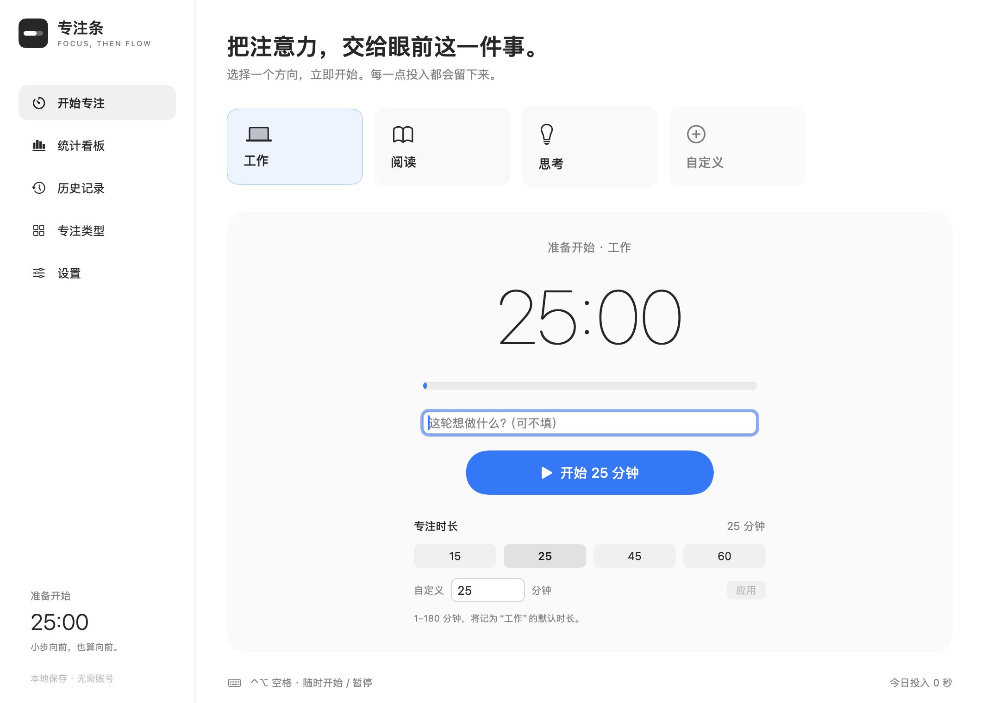
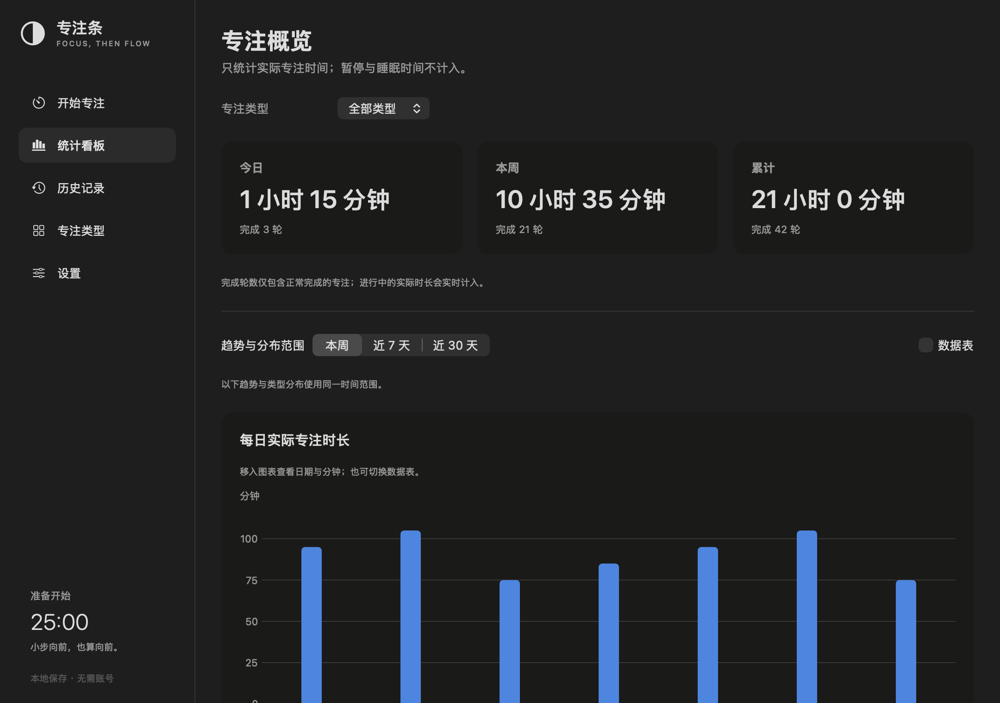
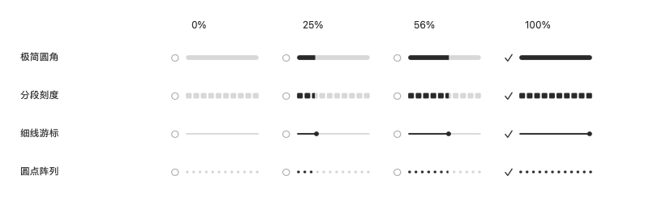

# 专注条 · FocusBar



**想开始，就先专注 25 分钟。** 一个原生 macOS 专注工具：工作时只留下菜单栏进度条，回顾时打开独立窗口。

[下载测试版 DMG](https://github.com/Sam-byte1/focusbar-macos/releases) · [反馈问题](https://github.com/Sam-byte1/focusbar-macos/issues) · [MIT 许可证](LICENSE)

> **当前为早期测试版。** 下载包仅验证 Apple Silicon（M 系列）Mac，采用本地 ad-hoc 签名，**未使用 Developer ID 签名，也未经过 Apple 公证**。从网络下载后可能被 Gatekeeper 拦截；这不代表系统已验证其可信。非技术用户建议等待正式签名版，不要关闭 Gatekeeper、SIP 或其他系统安全保护。

## 为什么做专注条

**专注条想创造的，不只是一次计时，而是一个认真投入当下的开始。**

工作中，最难的往往不是坚持多久，而是从“想做”走到“开始做”。选择一件事，按下开始，把接下来的 25 分钟留给它——这个简单的动作，就是进入专注的仪式。不必等到状态完美，先投入，让状态在行动中慢慢出现。

倒计时让人知道还剩多少时间；专注条希望同时呈现另一个视角：**已经投入的时间，正在随着工作一点点向前。**

因此，倒计时之外，菜单栏里还有一条从空逐渐填满的进度条。它不需要被一直盯着，也不催促人赶到终点；只在偶尔抬眼时，让已经走过的这一段时间变得可见。时间不只是不断减少的余额，也是正在积累的投入。

倒计时为这一轮划出边界，正向进度条则陪伴投入的过程。进度填满，不等于任务必须完成，也不是对工作成效的评分，而是为这段认真投入的时间留下一个清晰的刻度。

> 给开始一点仪式感，让时间与投入一起向前。

## 功能

- **菜单栏进度条**：极简圆角、分段刻度、细线游标、圆点阵列，支持宽度和数字倒计时配置。
- **快速开始**：默认 25 分钟；15 / 25 / 45 / 60 分钟快捷选项；自定义 1–180 分钟。
- **自定义类型**：工作、阅读、思考是初始选项，均可改名、删除；自定义名称搭配 32 个预置图标。
- **直接编辑**：首页卡片单击选择、双击编辑或删除，也可右键操作。
- **完整计时**：暂停、继续、提前结束保存、重开和轻提醒；不自动进入休息。
- **真实记录**：实际投入累计，暂停和系统睡眠不计时；提前结束也保留投入。
- **统计看板**：今日、本周、累计时长，每日趋势、类型分布与数据表。
- **历史与导出**：按日期、类型、事项筛选，导出 CSV。
- **纯本地**：不需要账户，无服务器、云同步或遥测上传。

## 界面

截图使用**独立测试库的演示记录**，不会出现在新安装的实际历史中。

### 开始专注



### 统计看板



### 四款菜单栏样式



## 下载与安装

1. 在 [Releases](https://github.com/Sam-byte1/focusbar-macos/releases) 选择最新测试版。
2. 下载 `FocusBar-v2.0.0-beta.1-macOS-arm64.dmg`。
3. 打开 DMG，将 `FocusBar.app` 拖入 `Applications`，弹出磁盘后再运行应用。
4. 从主窗口或菜单栏开始专注；`Control + Option + 空格` 用于开始、暂停或继续。

macOS 可能阻止未公证软件打开。仅在确认来源、核对校验和并理解风险后，参考 [Apple 对无法打开应用的说明](https://support.apple.com/102445) 处理；不要通过关闭安全机制来绕过提示。也可以审阅源码后自行构建。

### 兼容性

| 项目 | 状态 |
|---|---|
| 已验证架构 | Apple Silicon / arm64 |
| 源码部署目标 | macOS 13 及以上 |
| 已实际运行系统 | macOS 27，Apple Silicon |
| macOS 13 / Intel | 尚未实机验证；不提供已验证兼容承诺 |
| Developer ID / Apple 公证 | 暂未进行 |
| App Store | 未上架 |

## 使用与数据规则

- 关闭主窗口不会退出或停止计时；点击 Dock 或菜单栏“打开主窗口”可再次打开。
- 运行中调整类型、默认时长、通知或声音，仅影响下一轮，不修改当前轮快照。
- 删除类型会保留历史和当前轮；至少保留一种可用类型。
- 系统睡眠、显示器休眠会暂停；锁屏通过系统事件尽力检测，可能随系统环境变化，离开前可手动暂停。
- 每日时长按有效片段和当前时区拆分，本周从周一开始；完成轮数按结束日统计。
- 正常退出保存中断记录；异常关闭后恢复最后成功检查点为暂停，不累计离线时间。正常写入条件下最多损失最后约 15 秒。
- 保存失败会提示，完成记录留在内存重试；损坏或未知版本数据只读保护，不静默覆盖。

本地目录：

```text
~/Library/Application Support/local.shijie.FocusBar/
├── focus-data.json         # 类型、设置、历史、活跃轮检查点
├── focus-data.backup.json  # 上一份有效快照
└── writer.lock             # 单写入实例保护
```

建议定期备份整个目录。提交问题时不要直接公开包含个人事项的完整数据文件。

## 从源码构建

需要 macOS 和 Apple Command Line Tools。当前已验证 Swift 6.4，使用 Swift 5 语言模式；完整 Xcode 不是命令行构建的必要条件。

```bash
git clone https://github.com/Sam-byte1/focusbar-macos.git
cd focusbar-macos
./tools/test.sh
./tools/build.sh
open ./build/FocusBar.app
```

- 构建脚本根据本机架构输出应用，不下载第三方依赖。
- 从仓库根目录运行脚本，不在 `TomatoBar/` 源码目录内执行。
- `build/FocusBar.app` 指向最新成功构建的实体目录；制作分发包时须复制应用实体，不要只打包链接。
- `.xcodeproj` 同步保留，但本次未使用完整 Xcode 验证。
- 资源位于 `assets/`，请克隆完整仓库，不要只下载 `TomatoBar/` 子目录。

### 测试

当前 **289 项检查通过**：计时模型 24、统计 86、存储 146、计时协调层 33；另有 640 组菜单栏绘制检查。覆盖暂停恢复、跨午夜/周/DST、损坏保护、旧格式、写入失败重试、删除类型保留历史等。

这些测试不能替代不同硬件及系统的实际安装验证。真实通知体验、锁屏/合盖、登录项及多显示器仍需更多反馈。

### 项目结构

```text
TomatoBar/TomatoBar/  # Swift 源码（沿用上游目录名）
TomatoBar/*.xcodeproj # 原生工程
assets/              # 原创 Logo、ICNS 与 PNG
tools/               # 构建、测试、绘图工具
tests/               # 自动化测试
docs/images/         # 经过筛选的界面截图
```

## 已知限制

- 未公证测试包可能无法在其他 Mac 上直接打开，不承诺免提示安装。
- 菜单栏可能随全屏、自动隐藏、刘海和图标拥挤而不可见，不是永久置顶覆盖层。
- 登录启动仅在用户点击时注册；开发位置或本地签名可能导致系统拒绝。
- 存储采用顺序原子 JSON 写入，大量历史可能产生 UI 写入延迟。
- 无自动更新、账户、云同步、阻止网站、任务管理和历史清空功能。
- 当前 SDK 曾输出 Charts 轴标签兼容警告及开发路径诊断，不能视为跨版本兼容保证。

## 来源与许可证

本项目基于 [ivoronin/TomatoBar](https://github.com/ivoronin/TomatoBar) 修改，基线提交：

```text
90a77d664dfe33c016bf24f89b0c82e77f9aec84
```

原版权及 MIT 许可保留，详见 [LICENSE](LICENSE) 和 [UPSTREAM.txt](TomatoBar/UPSTREAM.txt)。本仓库不是上游官方版本，也不表示上游背书。

上游单独授权的音效、旧品牌图标和原发布工作流未包含在公开版本中。FocusBar Logo 为项目原创，随本项目以 MIT 许可证提供；系统图标和提示音通过 macOS API 使用。
